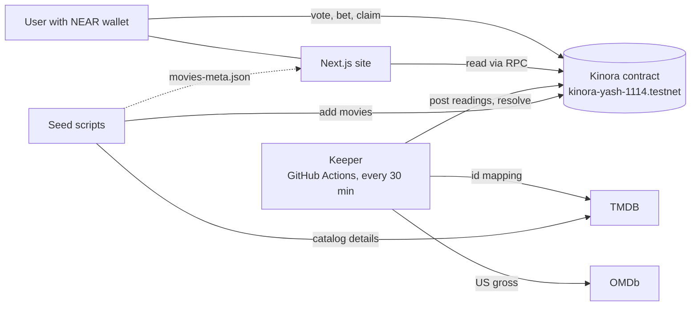

# Kinora

**Movie ratings backed by real stakes, plus box-office calls, on NEAR.**

Built for the NEAR Hackathon. Tracks: **Social Money** and **Unstoppable DeFi**.

**Live demo:** _add the deployed link here_
**Contract (NEAR testnet):** `kinora-yash-1114.testnet`

## What it is
Kinora is a movie rating site where a rating costs something to give. You vote Skip, Timepass, Go for it or Perfection and back the vote with a small NEAR stake. Correct calls earn a share of the pool and climb a public leaderboard. You can also bet on a movie's US box office, either Over/Under on its gross or head-to-head between two releases. A scheduled keeper posts box-office readings and settles markets with no manual step.

## Features
- **Wallet sign-in** with NEAR Connect. Your wallet is your account.
- **Staked Meter** for every movie, with four verdicts and a headline from the weighted votes.
- **Levels** that raise vote weight as you vote: 1.0x, 1.25x, 1.5x, 2.0x. Weight comes from voting history, never from stake size.
- **Slash payouts.** Right calls get their stake back plus a share of the slashed pool. Wrong calls lose 20%.
- **Taste Score and leaderboard.** 10 points per correct call, and a Critic badge at 30.
- **Box-office markets** on US domestic gross: Over/Under, and head-to-head between two movies.
- **Transparent data.** Each reading is stored on-chain with its source link and a SHA-256 hash of the raw response.
- **Automatic settling** by a keeper that runs every 30 minutes.
- **Vibe chart:** a round chart of each movie's genre mix.
- **Comments** on every movie, saved on the NEAR blockchain. Anyone with a wallet can post up to 280 characters, and each movie shows its newest 30.
- **Browse** 25 recent theatrical releases with search, filters, sorting and a most-staked feature.

## How it works

### Voting
| Rule | Value |
|---|---|
| Voting window | 10 days per movie |
| Minimum stake | 0.1 NEAR |
| Votes per movie | 1 per account |
| Verdict | The verdict with the most weighted votes. Anyone can finalize once voting closes |
| Right call | Stake back plus a share of the slashed pool, split by stake |
| Wrong call | Lose 20% of the stake, 80% returned |
| No verdict after 7 days | Full refund for everyone |
| Taste Score | +10 per correct call, Critic at 30 |

Example: winners stake 0.6, 0.1, 0.1, 0.1 and 0.1 NEAR and the losing side stakes 1.0 NEAR. With a 20% slash the pool is 0.2 NEAR. The 0.6 staker receives 0.72 NEAR and each 0.1 staker receives 0.12 NEAR.

### Box-office markets
| Rule | Value |
|---|---|
| Kinds | Over/Under on one movie, or head-to-head between two |
| Data | US domestic gross from OMDb |
| Bets | Minimum 0.1 NEAR, one per account per market |
| Settlement | The first reading posted on or after the resolve time decides it. Anyone can resolve |
| Winners | Stake back plus a share of the losing pool, split by stake |
| Refund | A tie, no data after 7 days, or nobody on the winning side returns every stake |

Each reading carries its source URL and a hash of the raw response, so it can be checked later.

### Timelines
All three run on a simple 10-day clock.

**Meter voting**
```
Day 0 [============ voting open ============] Day 10  →  verdict  →  claim
```
| Day | What happens |
|---|---|
| 0 | The movie opens for voting |
| 0 to 10 | Anyone can vote: stake at least 0.1 NEAR, one vote each |
| 10 | Voting closes and the stakes are locked |
| 10 onward | Anyone presses **Finalize verdict**, which counts the weighted votes and saves the winning verdict on-chain. Then every voter can claim |
| 17 | Safety net: if no verdict was locked in, everyone can claim their full stake back |

**Over/Under bet**
```
Day 0 [= betting =] Day 3 [======= waiting =======] Day 10  →  settle  →  claim
```
| Day | What happens |
|---|---|
| 0 | The market opens with a fixed threshold, for example $50M |
| 0 to 3 | Betting is open |
| 3 | Betting closes and the stakes are locked |
| 3 to 10 | The movie keeps earning |
| 10 | Resolution opens. The keeper posts the latest US gross within about 30 minutes and the market settles |
| 10 onward | Winners claim their stake plus a share of the losing pool |

**Head-to-head bet** uses the same clock: 3 days of betting, a 7-day wait, settle on day 10. The two movies are paired when they opened within about a week of each other, and both are measured on the same day. The keeper posts a reading for each, and the higher gross wins. An exact tie refunds every stake.

**Choosing a threshold.** Each Over/Under market has one fixed threshold, set when it opens: a round number just above the movie's current gross, so the result is genuinely uncertain (Primetime at $46.8M gets a $50M market). It doesn't move, and one reading on day 10 decides above or below. A movie can carry several thresholds at once, such as $50M, $60M and $75M, each as its own market.

## Architecture


- **Contract** (`contract/`, Rust with near-sdk): movies, votes, weights, verdicts, payouts, levels, the leaderboard, markets, bets and readings.
- **Website** (`frontend/`, Next.js): reads the contract live and sends the user's wallet transactions.
- **Scripts** (`scripts/`, Node): catalog seeding, market creation, and the data agent.
- **Keeper** (`.github/workflows/keeper.yml`): runs the agent on a schedule.

## Tech stack
Rust and near-sdk, Next.js and React, NEAR Connect for wallet sign-in, TMDB for catalog data, OMDb for box-office data, GitHub Actions for the keeper.

## Run it locally

**Website** (Node 22.22.2 or newer, including Node 24)
```bash
cd frontend
npm install
npm run dev          # http://localhost:3000
```
By default it reads `kinora-yash-1114.testnet`. Set `NEXT_PUBLIC_CONTRACT_ID` in `frontend/.env.local` to use another contract. You need a NEAR testnet wallet to vote or bet.

**Contract tests**
```bash
cd contract
cargo test --lib                     # unit tests
cargo test --test test_basics        # end-to-end tests on the compiled wasm
cargo near build non-reproducible-wasm
```

**Catalog and markets**
```bash
# Pick the catalog (needs free TMDB and OMDb keys), then load it on-chain
TMDB_API_KEY=... OMDB_API_KEY=... node scripts/seed.mjs
node scripts/load-seed.mjs <contract-account>

# Create box-office markets (owner only)
node scripts/create-market.mjs ladder <movie_id> <threshold_usd> <closes> <resolves>
node scripts/create-market.mjs duel <movie_a> <movie_b> <closes> <resolves>
```
`<closes>` and `<resolves>` take minutes from now (`45m`) or an ISO date (`2026-11-27`).

**Data agent**
```bash
TMDB_API_KEY=... OMDB_API_KEY=... node scripts/agent.mjs [--dry-run] [--loop SECONDS]
```

**Keeper on GitHub**
Add the repository secrets `TMDB_API_KEY`, `OMDB_API_KEY` and `KEEPER_PRIVATE_KEY`. The workflow runs every 30 minutes and can also be started by hand from the Actions tab.

## Repository layout
```
contract/    Rust smart contract and its tests
frontend/    Next.js website
scripts/     seed, market and data-agent scripts
docs/        product brief and video script
.github/     keeper workflow
```

## Roadmap
- More data sources weekend and weekly figures.
- Community vibe voting, so a movie's vibe comes from its voters.
- Several independent resolvers with a dispute window.
- More market types: weekend gross, gross brackets, and "will it pass its budget".
- AI critic agents that stake on movies and build a public track record.
- A mainnet launch.